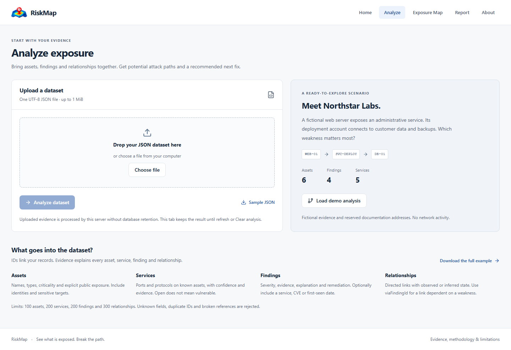
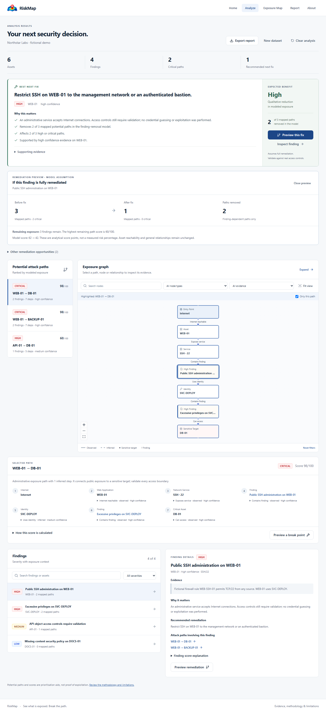

<p align="center"></p>

# RiskMap

**Map security exposures into attack paths and identify the highest-impact fix.**

<p><a href="LIVE_DEMO_URL"></a></p>

`LIVE_DEMO_URL` is a publication placeholder. Replace it with the verified deployment URL before advertising a hosted demo.

## Overview

RiskMap connects assets, services, findings and relationships into potential attack paths, then recommends a **Best Next Fix** backed by the supplied evidence. It is a focused exposure analysis tool for local use and portfolio demonstrations.

Upload a dataset → inspect the exposure graph → understand attack paths → preview a fix → export a report.

No account, subscription, team workflow, database setup or background worker is required for this workflow. Analysis does not scan networks or exploit targets. Scores and potential paths are analytical prioritisation aids, **not proof that exploitation occurred**.


## Key features

- Strict asset, service, finding and directed-relationship ingestion.
- Interactive exposure graph with observed/inferred evidence and exact path highlighting.
- Bounded, cycle-safe attack-path analysis and transparent scoring.
- Best Next Fix, supporting evidence, alternatives and a before/after preview.
- Fictional demo, JSON/CSV exports and branded print/PDF reports.



## Quick start

Use a maintained Node.js 22 release (22.16 or later) or Node 24. CI and Docker use Node 24.

```bash
npm ci
npm run dev
```

Open [RiskMap locally](http://localhost:3000). Select **Analyze → Load demo analysis** for an instant fictional scenario. There are no demo credentials to enter. An `.env` file is not required for the active product.

For a production preview:

```bash
npm run build
npm start
```

The optional local preview helper binds to loopback and launches only the analysis server:

```bash
npm run runtime:start
npm run runtime:status
npm run runtime:stop
```

Optional Docker Compose runs one web service, bound to `127.0.0.1:3000`, without persistence volumes, migration startup or a worker. Node standalone hosting does not require Docker. See [deployment](docs/DEPLOYMENT.md) for HTTPS proxies, standalone startup and separate frontend/API hosting.

## Workflow and navigation

| Page         | Purpose                                                                             |
| ------------ | ----------------------------------------------------------------------------------- |
| Home         | Explain the product and enter analysis or the demo                                  |
| Analyze      | Validate a dataset, see priorities, inspect paths and findings, preview remediation |
| Exposure Map | Explore the graph with more space, zoom, pan, filters and evidence                  |
| Report       | Read the decision report and export JSON, CSV or a print/PDF version                |
| About        | Explain scoring, Best Next Fix, security and limitations                            |

Results stay in this tab's memory across navigation. Refresh, closing the tab or **Clear analysis** removes them. Nothing is stored in local storage, cookies or the database by the analysis workflow.

## Supported input

Upload one UTF-8 **JSON** dataset, version `1`, with all four collections. Services, findings and relationships may be empty. Assets must contain at least one record.

Download the [complete fictional dataset](public/demo-dataset.json) from the Analyze screen as a practical template.

| Collection    | Fields                                                                                                                                                             |
| ------------- | ------------------------------------------------------------------------------------------------------------------------------------------------------------------ |
| Assets        | `id`, `name`, `type`, `criticality`, `public`, `evidence`                                                                                                          |
| Services      | `id`, `assetId`, `port`, `protocol`, `confidence`, `evidence`                                                                                                      |
| Findings      | `id`, `assetId`, optional `serviceId`, `title`, `severity`, `confidence`, `category`, `description`, `evidence`, `remediation`, optional `cve` and ISO `firstSeen` |
| Relationships | `id`, `from`, `to`, `type`, `state`, `confidence`, `evidence`, optional `viaFindingId`                                                                             |

The top-level fields are `version`, `name`, `assets`, `services`, `findings` and `relationships`. The schema rejects unknown fields, duplicate IDs within a collection, invalid ports and broken references. A service linked to a finding must belong to that finding's asset. A finding-dependent relationship must reference a finding on its source asset.

Limits: **1 MiB**, 100 assets, 200 services, 200 findings and 300 relationships. Accepted asset types and relationship types are defined in [`lib/analysis/dataset.ts`](lib/analysis/dataset.ts). CSV is a report export format, not an ingestion format. Scanner-specific imports need an adapter to this schema.

### Relationship semantics

`public: true` explicitly creates an Internet entry edge. RiskMap does not infer public exposure from an asset name, an IP string or its type.

Use `viaFindingId` when a transition depends on a weakness. For example, a web server's potential access to its deployment account can depend on a public administrative-exposure finding. That relationship is represented through the finding node and is removed when previewing that fix. A general relationship without a finding gate remains after remediation; its existence does not prove that an attacker can compromise either endpoint.

Every edge distinguishes **observed** from **inferred** evidence and carries a supplied confidence level. Sensitive targets are assets of type `CRITICAL_ASSET` or with `CRITICAL` criticality. Identity assets are distinct from servers and services.

## Attack-path logic

The existing bounded, cycle-safe depth-first search starts at Internet entry points. A recorded path needs a finding, a meaningful service/exposure step and a sensitive target. Ordered nodes **and edges** identify a path, so parallel relationships with different evidence remain distinguishable.

Search stops at eight nodes, 400 recorded paths or 30,000 explored states. Reaching a search budget sets an explicit completeness flag; the UI and reports identify the mapped subset. The engine never presents that subset as an exhaustive assessment. Maximum depth is a modeling boundary even when no budget is reached.

Selected paths highlight their exact edges. The graph has ranked placement, node labels, zoom/pan, Fit view, node and evidence filters, a restrained legend, and node/edge evidence details. The textual path view provides the complete relationship chain and remediation opportunities alongside the graph.

## Risk-scoring philosophy

Path scoring combines entry exposure, finding severity, asset criticality, service sensitivity, chain length, administrative exposure and data/API context. Inferred steps carry a penalty; confidence adjusts the result. Scores are clamped to 0–100. The UI exposes the contributing terms.

Finding scoring uses supplied severity and confidence, asset importance, explicit public exposure, a supplied first-seen date and mapped path participation. Contributions are capped and combined with diminishing weights. Imports do not receive a fabricated "new finding" or correlated-findings bonus. The analysis timestamp is held constant throughout a remediation preview.

Path labels: critical ≥80, high ≥60, medium ≥35, otherwise low. Supplied finding severity is separate from the path label. Scores are relative analytical aids, not probabilities or a calibrated measure of real-world loss.

## Best Next Fix

For every candidate finding, the existing simulation engine removes its node and dependent edges in memory, searches again and recalculates finding scores. Ranking weighs:

- change in the deterministic model score;
- mapped paths provably broken because they contain the candidate finding;
- the aggregate scores of those affected paths;
- finding severity, asset importance and supplied confidence;
- a rough category-based effort estimate.

A tie preserves input order. Candidates that change neither mapped paths nor the rounded model score are omitted. The primary recommendation shows the actual remediation, target asset, supplied severity, confidence, path impact, evidence and qualitative benefit. Two alternatives remain available. Qualitative benefit is **High** for at least two affected high/critical paths or at least 12 model-score points, **Moderate** for any affected path or at least five model-score points, otherwise **Limited**. These labels describe the model, not verified remediation effectiveness.



The before/after view assumes complete remediation of that finding. It keeps inventory, public reachability, general dependencies and other findings in place. Exact path counts describe the modeled change; score-point differences are not risk percentages. Revalidate real access controls and import updated evidence after implementing a fix.


## Fictional demo

Northstar Labs has six assets, five services, four findings and four supplied relationships. It tells one understandable story:

Internet → WEB-01 → public SSH finding → SVC-DEPLOY → excessive privilege finding → DB-01 / BACKUP-01.

A separate API boundary reaches DB-01. A missing documentation-site header remains a finding outside mapped paths. The demo maps three potential paths, two critical. Its Best Next Fix restricts public SSH on WEB-01; the preview removes the two critical paths and leaves the API path. Every observation is explicitly fictional, with reserved documentation addresses and no network activity.

## Reports

Reports contain an executive summary, asset context, critical/high findings, attack paths, Best Next Fix, evidence, remediation, remaining risk, methodology and limitations.

- **JSON:** complete input, graph, scoring contributors, paths, recommendation candidates and completeness information.
- **CSV:** every finding, asset, evidence, explanation, remediation, path count and priority marker. Formula prefixes, including whitespace-prefixed formulas, are neutralised.
- **Print / Save PDF:** a dedicated A4 print layout through the browser's print dialog. This is not a server-side PDF generation service.

Exports use the current immutable analysis snapshot. React escapes report-controlled text; downloaded filenames are bounded and sanitised.

## Architecture

Next.js App Router / React → tab-scoped analysis provider → `POST /api/analyze` → strict Zod parser → existing pure graph constructor → bounded path search → existing scoring and remediation simulation → UI and report exports.

The pure graph constructor was extracted from the existing database graph service into `lib/services/exposure-model.ts`; the earlier persistence service re-exports it. The active pipeline does not import Prisma database access or scanning providers. `GET /api/health` checks the web process without requiring a database or worker.

Obsolete enterprise UI/API handlers, dead import adapters and superseded browser tests have been removed. Authentication, tenants, billing, teams, assignments, alerts, scan administration and historical dashboards are not active product features. The original Prisma schema, migration, reconciliation/history engines, safe network checks and backend regressions remain for compatibility with existing data. Existing user databases are preserved. `tests/browser` is the active browser suite.

The retained database/worker scripts and `.env.compatibility.example` apply only to compatibility modules. These are excluded from the standalone application image. `.env.example` documents active hosting configuration.

## Security model

The active tool parses supplied data; it makes no outbound requests to the addresses, hostnames or references in that data. Uploads are processed transiently by the server and are not written to a database. Use a trusted local deployment for private evidence.

The request reader enforces declared and streamed byte limits, JSON content type, UTF-8 decoding and same-origin browser requests by default. Explicit origin allowlisting supports HTTPS proxies and a separately hosted frontend. CORS never uses wildcard origins or credentials. Schema validation bounds text and collection sizes. Paths have explicit work budgets. A global per-process budget allows 60 requests per minute without trusting client-controlled forwarded IP headers. Errors avoid stack traces and internal paths. Security headers, output escaping and formula-safe CSV remain in place.

This local portfolio deployment has no account-based ownership model because it stores no analysis records. Public hosting requires infrastructure-level body, timeout, concurrency and distributed rate limits. No multi-user isolation or persistent analysis history is provided.

## Validation

```bash
npm run format:check
npm run lint
npm run validate
npm test
npm run validate:performance
npm run build
npm run typecheck
npm audit --omit=dev --audit-level=high
npm audit --audit-level=high
npx playwright install chromium
npm run test:e2e
```

The unit suite covers path/scoring, parsers, reports, network safety, lifecycle behavior, deployment origins/CORS and publication regressions. The integration suite creates only `prisma/integration.db`, applies its migration and exercises the real reconciliation pipeline across fictional snapshots; it never uses `prisma/dev.db`.

The active Playwright suite runs against a production web server with no worker or seeded database. It checks the complete workflow, JSON/CSV downloads, model comparison, errors, loading and empty states, removed API surfaces, keyboard access and axe WCAG checks. It captures 1440, 1366, 768 and 390 pixel layouts. Windows can use installed Edge; `PLAYWRIGHT_CHROMIUM_EXECUTABLE_PATH` selects an explicit local browser. CI uses managed Chromium.

The performance check measures the actual graph/path/recommendation pipeline on the demo and a maximum-size synthetic inventory. Results are machine-local timings, not a general capacity guarantee. See [`FINAL_VALIDATION.md`](FINAL_VALIDATION.md) for executed checks and remaining limitations.

## Limitations

- Supplied evidence and confidence may be incomplete, stale or incorrect.
- A CVE reference does not establish exploitability; an open service is not automatically a vulnerability.
- No exploitation, live discovery, credential validation or independent environment verification occurs.
- Depth and work limits can omit paths; finding removal is an assumption rather than a confirmed fix.
- Results disappear on refresh. There is no persistent saved-analysis or history dashboard.
- Input supports RiskMap JSON rather than arbitrary scanner formats.
- PDF output depends on the browser print renderer.
- Database reconciliation and network-safety regression modules remain for compatibility; they are not active routes or container runtime dependencies.

## License

MIT. See [LICENSE](LICENSE).

## Author

RiskMap contributors.
