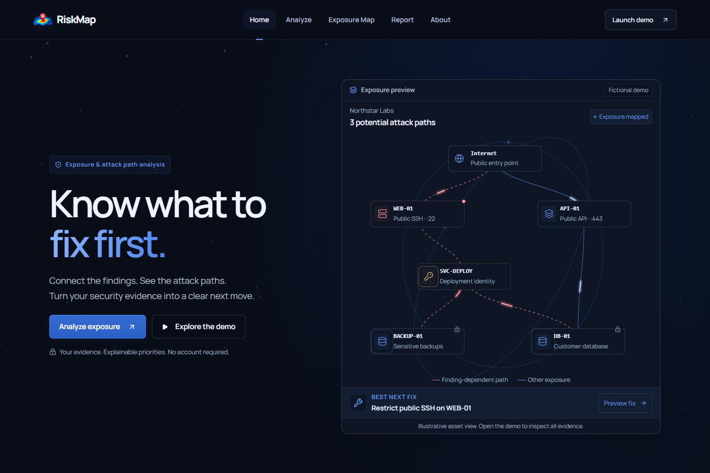
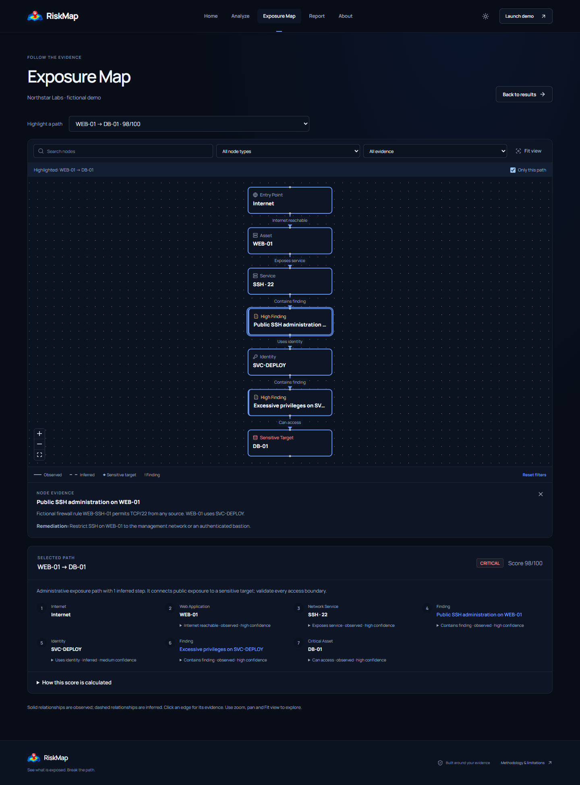

<p align="center"></p>

# RiskMap

**Map security exposures into attack paths and identify the highest-impact fix.**

RiskMap connects supplied assets, services, findings and relationships into potential attack paths, then recommends a **Best Next Fix** backed by that evidence.

Upload a dataset → inspect the exposure graph → preview a fix → export a report.



## Quick start

Use Node.js 22.16 or later in the Node 22 line, or Node 24. CI and Docker use Node 24.

```bash
npm ci
npm run dev
```

Open [RiskMap locally](http://localhost:3000) and choose **Analyze → Load demo analysis**. The active application requires no account, environment file, database setup or worker.

For a production preview:

```bash
npm run build
npm start
```

See [deployment](docs/DEPLOYMENT.md) for alternate ports, the loopback preview helper, Docker and HTTPS hosting.

## What it does

- Validates a versioned JSON dataset and its references.
- Maps directed exposure paths with observed/inferred evidence and confidence.
- Explains priorities through bounded path analysis and deterministic scoring.
- Previews the modeled effect of a finding's remediation.
- Exports JSON, findings CSV and a browser print/PDF report.

| Page         | Purpose                                                                    |
| ------------ | -------------------------------------------------------------------------- |
| Analyze      | Upload evidence, inspect findings and paths, and preview the Best Next Fix |
| Exposure Map | Explore the graph, filters and connection evidence                         |
| Report       | Read the decision report and export the current snapshot                   |
| About        | Understand the methodology and limitations                                 |



## Input and demo

Upload one UTF-8 JSON dataset with `version: 1`, `name`, `assets`, `services`, `findings` and `relationships`. Assets must contain at least one record; the other collections may be empty.

Limits are **1 MiB**, 100 assets, 200 services, 200 findings and 300 relationships. Unknown fields, duplicate IDs and broken references are rejected. CSV is an export format.

Use the [fictional Northstar Labs dataset](public/demo-dataset.json) as a template. It contains six assets, five services, four findings and three potential paths. Restricting public SSH on WEB-01 removes two modeled paths while the API path remains.

See [architecture and input reference](docs/ARCHITECTURE.md) for field names, relationship semantics, path limits and scoring behavior. The exact accepted values are defined in [the dataset schema](lib/analysis/dataset.ts).

## Reports and data handling

Results stay in the current tab's memory across navigation. Refresh, closing the tab or **Clear analysis** removes them. Uploaded evidence is processed transiently by the server without database retention.

- **JSON:** the input, graph, scoring, paths, recommendations and completeness information.
- **CSV:** findings with asset context, evidence, remediation and priority markers.
- **Print / Save PDF:** the report's A4 layout through the browser print dialog.

RiskMap analyzes supplied evidence without scanning networks or exploiting targets. Paths and scores are prioritisation aids; remediation previews assume a finding is fully resolved. Incomplete input and bounded searches can omit paths. Use a trusted deployment for private evidence; see the [security policy](SECURITY.md).

## Project documentation

| Guide                                  | Contents                                                                |
| -------------------------------------- | ----------------------------------------------------------------------- |
| [Architecture](docs/ARCHITECTURE.md)   | Runtime, input schema, paths, scoring, recommendations and limitations  |
| [Deployment](docs/DEPLOYMENT.md)       | Local and production startup, hosting configuration and troubleshooting |
| [Testing](docs/TESTING.md)             | Repeatable checks, browser setup and release acceptance                 |
| [Compatibility](docs/COMPATIBILITY.md) | Retained database, scanning and worker regression modules               |

The compatibility modules support existing data and backend tests. They are separate from the active stateless application and excluded from its standalone runtime image.

For development and review guidance, see [Contributing](CONTRIBUTING.md).

## License

MIT. See [LICENSE](LICENSE). Bundled Manrope fonts retain their [SIL Open Font License](public/fonts/OFL.txt).
